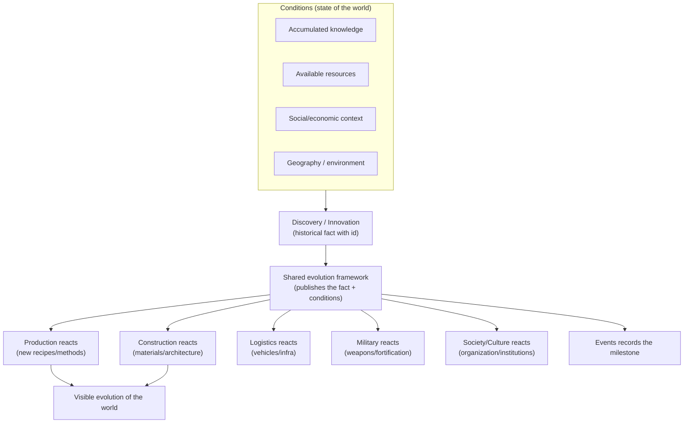

# HISTORICAL_EVOLUTION_FRAMEWORK — Civilization Evolutions

> **Phase 2 — Conceptual framework for historical evolution.** How to represent historical evolution **without** a rigid technology tree or a mandatory chronology. Core idea: a **shared framework** of discoveries, conditions and events that **all systems react to**, instead of isolated effects within each system. Authority: [GDD_Technology_Science_and_Innovation](docs/01-systems/GDD_Technology_Science_and_Innovation_v0.1.md), [GDD_Events...](docs/01-systems/GDD_Events_and_Historical_Evolution_v0.1.md), [GDD_Construction...](docs/01-systems/GDD_Construction_and_Architecture_v0.1.md). Decisions: DC-01, DC-09, DR-01, DR-11.
> Version 1.0 · Status: conceptual.

## 1. Principles

1. **Periods = references, not mandatory stages** (DC-01). Paleolithic→start of the Industrial Revolution serves as a plausibility context; a civilization may follow different paths.
2. **Evolution driven by conditions, not by the year** (DC-09): an advance occurs when there is **knowledge + resources + social/economic context**, not because a date arrived.
3. **Availability ≠ adoption** (DR-11): discovering something **enables** it; adopting it requires materials, labor and a decision. The old can coexist.
4. **Reaction, not scripting** (RISK-05): systems **listen** to shared discoveries/conditions/events and apply their own rules; knowledge does not implement effects inside other systems.
5. **Exceptional knowledge loss** (Technology): regression is not the norm.

## 2. Conceptual model

A **Discovery** is an entity (id, discipline, condition prerequisites, enabled effects). The **shared framework** publishes it together with the conditions; each system decides **whether/how** it adopts, with its own rules. This way the same innovation changes several domains without Technology knowing their implementation.

## 3. Conditions for discoveries and innovation

A discovery becomes **possible** when combinable conditions are met (not a single prerequisite per year):
- **Prior knowledge** (other related technologies/disciplines).
- **Accessible resources** (e.g. minerals for metallurgy).
- **Social/economic context** (specialization, surpluses, education, institutions).
- **Geography** (rivers→irrigation/transport; coasts→navigation; mountains→mining).
- **Exchange** (diffusion from another civilization).
It becomes **adopted** when, in addition, there are materials + labor + a decision (by the player or autonomous).

## 4. Interaction technology ↔ geography ↔ resources ↔ society

- **Geography/resources** condition which discoveries are plausible and when (early metallurgy with minerals + craftsmanship).
- **Society** (specialization, education, institutions, surpluses) accelerates or slows innovation.
- **Technology** changes production/construction/transport/military/organization, which in turn change society (a loop).
- None of this depends on the **year**; it depends on the **state**.

## 5. Diffusion between civilizations

- Knowledge is transmitted through **trade, migration, diplomacy, war and contact** (Technology §9).
- Each civilization adopts according to its conditions; diffusion does **not** automatically homogenize (AI/diverse paths).
- Diffusion produces **events** (technology exchange) that Events records.

## 6. Cultural and institutional evolution

- **Culture/Religion/Politics** evolve organically and can be influenced, not by unlocking (Culture §17, Religion §17, Politics §14).
- Institutions and practices emerge/change/disappear; traditions can survive for centuries (Population/Culture).
- Institutional evolution reacts to conditions (size, economy, technology, events), just like technological evolution.

## 7. Buildings and infrastructure across the centuries

- **Buildings evolve** visually and functionally through triggers (technological/historical/cultural/economic), **chosen by the player**, not automatically (DC-03, Production §11, Construction §4).
- The **old coexists** with the new: obsolete buildings keep working; heritage can be preserved; abandonment leads to decay/ruins.
- The city preserves the **imprint** of its history (historic centers).

## 8. Alternative development paths

- There is no single sequence: a civilization may prioritize agriculture, trade, science, religion or the military and arrive at different configurations.
- **Stagnation** is possible (without conditions, there is no advance).
- Historical periods describe *ranges of plausibility*, not checkpoints.

## 9. Lasting consequences of events

- **Events** (droughts, epidemics, wars, reforms, discoveries) generate chains of short- and long-term consequences (Events §5) and remain in the **historical memory**.
- Consequences are applied by the **owning systems**; Events **records** (DC-14). The legacy feeds Progression.

## 10. Implementation implications (so as not to script)

- Model the **discoveries/conditions as data** (not code per system).
- A **shared channel** (typed events) publishes historical facts; systems **subscribe**.
- Separate **enabling** (Technology) from **adopting/transforming** (Production/Construction) from **recording** (Events).
- Avoid `if (año == X)`; use state conditions.
- Defer to E4 of the [DEVELOPMENT_ROADMAP.md](DEVELOPMENT_ROADMAP.md); confirm DR-01/DR-11 first.
