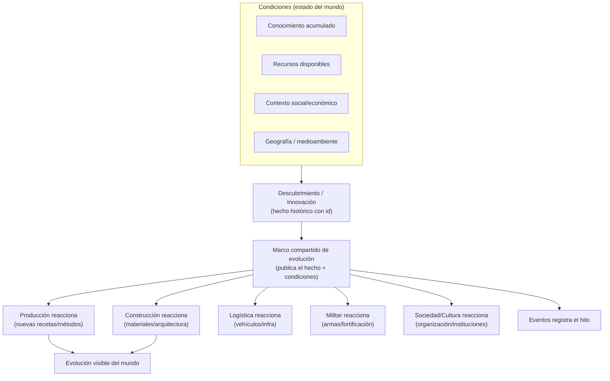

# HISTORICAL_EVOLUTION_FRAMEWORK — Civilization Evolutions

> **Phase 2 — Marco conceptual de evolución histórica.** Cómo representar la evolución histórica **sin** un árbol tecnológico rígido ni una cronología obligatoria. Idea central: un **marco compartido** de descubrimientos, condiciones y eventos al que **todos los sistemas reaccionan**, en vez de efectos aislados dentro de cada sistema. Autoridad: [GDD_Tecnologia_Ciencia_e_Innovacion](docs/01-systems/GDD_Tecnologia_Ciencia_e_Innovacion_v0.1.md), [GDD_Eventos...](docs/01-systems/GDD_Eventos_y_Evolucion_Historica_v0.1.md), [GDD_Construccion...](docs/01-systems/GDD_Construccion_y_Arquitectura_v0.1.md). Decisiones: DC-01, DC-09, DR-01, DR-11.
> Versión 1.0 · Estado: conceptual.

## 1. Principios

1. **Períodos = referencias, no etapas obligatorias** (DC-01). Paleolítico→inicio Revolución Industrial sirve de contexto de plausibilidad; una civilización puede seguir caminos distintos.
2. **Evolución dirigida por condiciones, no por el año** (DC-09): un avance ocurre cuando existen **conocimiento + recursos + contexto social/económico**, no porque llegó una fecha.
3. **Disponibilidad ≠ adopción** (DR-11): descubrir algo lo **habilita**; adoptarlo requiere materiales, mano de obra y decisión. Lo viejo puede coexistir.
4. **Reacción, no scripting** (RISK-05): los sistemas **escuchan** descubrimientos/condiciones/eventos comunes y aplican sus propias reglas; el conocimiento no implementa efectos dentro de otros sistemas.
5. **Pérdida de conocimiento excepcional** (Tecnología): la involución no es normal.

## 2. Modelo conceptual

Un **Descubrimiento** es una entidad (id, disciplina, prerrequisitos de condición, efectos habilitados). El **marco compartido** lo publica junto con las condiciones; cada sistema decide **si/cómo** adopta, con sus reglas. Así una misma innovación cambia varios dominios sin que Tecnología conozca su implementación.

## 3. Condiciones para descubrimientos e innovación

Un descubrimiento se vuelve **posible** cuando se cumplen condiciones combinables (no un prerrequisito único por año):
- **Conocimiento previo** (otras tecnologías/disciplinas relacionadas).
- **Recursos accesibles** (p. ej. minerales para metalurgia).
- **Contexto social/económico** (especialización, excedentes, educación, instituciones).
- **Geografía** (ríos→riego/transporte; costas→navegación; montañas→minería).
- **Intercambio** (difusión desde otra civilización).
Se vuelve **adoptado** cuando además hay materiales + mano de obra + decisión (del jugador o autónoma).

## 4. Interacción tecnología ↔ geografía ↔ recursos ↔ sociedad

- La **geografía/recursos** condicionan qué descubrimientos son plausibles y cuándo (metalurgia temprana con minerales + artesanía).
- La **sociedad** (especialización, educación, instituciones, excedentes) acelera o frena la innovación.
- La **tecnología** cambia producción/construcción/transporte/militar/organización, que a su vez cambian la sociedad (bucle).
- Nada de esto depende del **año**; depende del **estado**.

## 5. Difusión entre civilizaciones

- El conocimiento se transmite por **comercio, migración, diplomacia, guerra y contacto** (Tecnología §9).
- Cada civilización adopta según sus condiciones; la difusión **no** homogeneiza automáticamente (IA/caminos diversos).
- La difusión produce **eventos** (intercambio tecnológico) que Eventos registra.

## 6. Evolución cultural e institucional

- **Cultura/Religión/Política** evolucionan de forma orgánica e influenciable, no por desbloqueo (Cultura §17, Religión §17, Política §14).
- Instituciones y prácticas surgen/cambian/desaparecen; las tradiciones pueden sobrevivir siglos (Población/Cultura).
- La evolución institucional reacciona a condiciones (tamaño, economía, tecnología, eventos), igual que la tecnológica.

## 7. Edificios e infraestructura a lo largo de los siglos

- Los **edificios evolucionan** visual y funcionalmente por desencadenantes (tecnológicos/históricos/culturales/económicos), **elegido por el jugador**, no automático (DC-03, Producción §11, Construcción §4).
- Lo **viejo coexiste** con lo nuevo: edificios obsoletos siguen funcionando; se puede conservar patrimonio; el abandono lleva a deterioro/ruinas.
- La ciudad conserva la **huella** de su historia (centros históricos).

## 8. Caminos de desarrollo alternativos

- No hay una secuencia única: una civilización puede priorizar agricultura, comercio, ciencia, religión o milicia y llegar a configuraciones distintas.
- El **estancamiento** es posible (sin condiciones, no hay avance).
- Los períodos históricos describen *rangos de plausibilidad*, no checkpoints.

## 9. Consecuencias duraderas de los eventos

- Los **eventos** (sequías, epidemias, guerras, reformas, descubrimientos) generan cadenas de consecuencias de corto y largo plazo (Eventos §5) y quedan en la **memoria histórica**.
- Las consecuencias las aplican los **sistemas dueños**; Eventos **registra** (DC-14). El legado alimenta Progresión.

## 10. Implicaciones de implementación (para no scriptear)

- Modelar los **descubrimientos/condiciones como datos** (no código por sistema).
- Un **canal común** (eventos tipados) publica hechos históricos; los sistemas se **suscriben**.
- Separar **habilitar** (Tecnología) de **adoptar/transformar** (Producción/Construcción) de **registrar** (Eventos).
- Evitar `if (año == X)`; usar condiciones de estado.
- Diferir a E4 del [DEVELOPMENT_ROADMAP.md](DEVELOPMENT_ROADMAP.md); confirmar DR-01/DR-11 antes.
