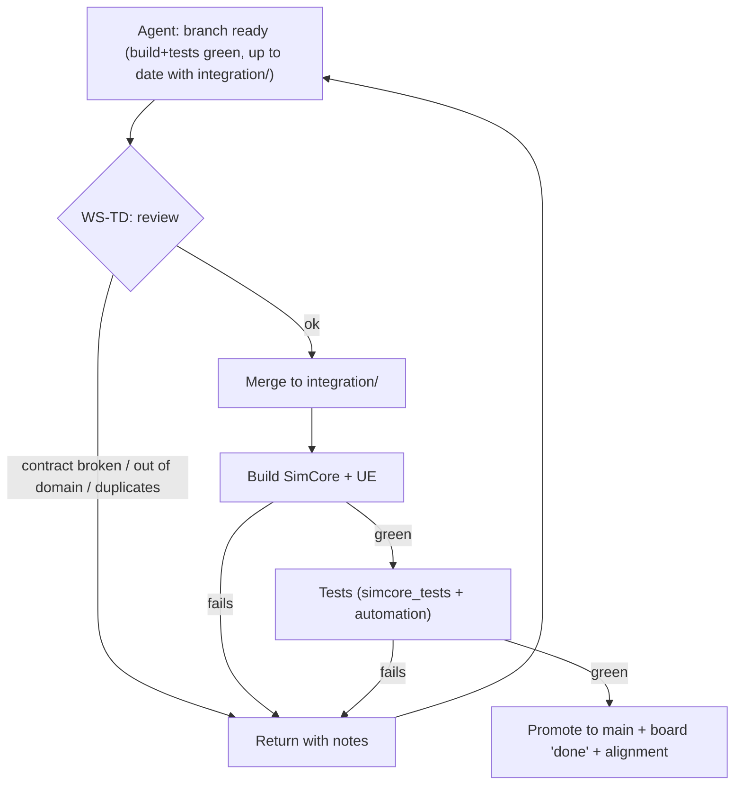

# INTEGRATION_STRATEGY — Civilization Evolutions

> **Central integration process.** How the **Technical Director (WS-TD)** gathers the workstreams' work while keeping contracts, dependencies and the build green. Complements [GIT_WORKFLOW.md](GIT_WORKFLOW.md) (git mechanics) and [SYSTEM_CONTRACTS.md](SYSTEM_CONTRACTS.md) (what is validated).
>
> Version 1.0 · 2026-11-04 · Status: PROPOSAL.

## Principle

**A single integrator: WS-TD.** No one promotes to `main` on their own. Integration is the point where architectural coherence (sim/presentation separation, no duplication, stable contracts) that parallelism puts at risk is protected.

## Technical Director responsibilities

1. **Review interfaces.** That the change respects the [SYSTEM_CONTRACTS.md](SYSTEM_CONTRACTS.md) contracts and, if it changes them, that it is deliberate, versioned and announced to the consumers.
2. **Review the implementation.** That it lives in the correct file/domain ([AGENT_OWNERSHIP_MAP.md](AGENT_OWNERSHIP_MAP.md)); that it does not put simulation logic in presentation (RISK-01); that it does not duplicate concepts (RISK-02); that it does not add empty abstractions (RISK-11).
3. **Validate dependencies.** That the task's dependencies are `done` and that it does not break downstream consumers.
4. **Integrate** complete branches into `integration/<repo>` (UE and/or docs).
5. **Build and test** after each integration (SimCore + UE build + tests).
6. **Update status** on the board ([AGENT_TASK_BOARD.md](AGENT_TASK_BOARD.md)) and the `IMPLEMENTATION_ALIGNMENT.md` snapshot.
7. **Record decisions** of architecture in `DESIGN_DECISION_REGISTER.md` and contradictions in `AUDIT_REPORT.md` (DR-08: design authority belongs to the GDDs; TD does not rewrite confirmed design, it documents and escalates).

## Integration flow (per request)

**Order by dependencies (bottom-up of the graph, [SYSTEM_DEPENDENCY_MAP.md](SYSTEM_DEPENDENCY_MAP.md)):** first foundations (CORE: time/events/identity/save-load), then ECON (resources/inventory) and WORLD, then BUILD/POP, and UI/ART on top. Do not integrate a consumer before the contract it depends on.

## Cadence

- **Continuous integration per task:** each green task is integrated as soon as it passes review; long branches are not accumulated (reduces conflicts, RISK-12).
- **Checkpoint per milestone:** on closing M0/M1/M2/M3/M4, WS-TD runs a full validation (build + the whole suite + a scenario from [CROSS_SYSTEM_VALIDATION_SCENARIOS.md](CROSS_SYSTEM_VALIDATION_SCENARIOS.md)) and updates the roadmap/alignment.
- **M0 is the big unblocker:** until the M0 refactor (splitting `Simulation`/`World`) and the contracts are integrated, real parallelism is limited; WS-TD prioritizes M0.

## Acceptance gates for an integration

A branch is promoted only if **all** is met:

- [ ] SimCore build green; `simcore_tests` green (87+ checks).
- [ ] UE editor build green (editor closed).
- [ ] Respects the task's allowed files; did not touch restricted ones.
- [ ] Does not break contracts; if it changes them, they are versioned and announced.
- [ ] No duplication of shared concepts (resource/entity/inventory/clock).
- [ ] No new simulation logic in the presentation layer (except what was already agreed under Model A, in the process of being inverted by Task F).
- [ ] Determinism intact if it touched clock/serialization (`save_load_roundtrip`).
- [ ] Task with new tests when it adds rules (coordinated with WS-QA).
- [ ] Decisions/risks recorded if applicable.

## Handling contract changes

1. The workstream that needs to change a contract **proposes it to WS-TD** (it does not change it in the owner's file on its own).
2. WS-TD assesses the impact on consumers (owner→consumers table in [SYSTEM_CONTRACTS.md](SYSTEM_CONTRACTS.md)).
3. The contract is versioned and **all consumers are notified** before integrating.
4. Consumers adapt their mocks/implementations; only then is the change integrated.
5. Live case: **M2-POP-01** (invert Model A authority: have SimCore drive hunger/health) touches contracts §5 and §7 → it is `blocked` until WS-TD validates and notifies ECON/UI.

## Conflict resolution between workstreams

- **File (text):** the agent resolves them on their branch after pulling `integration/`; if it is a 🤝 shared one, with the owner.
- **Contract:** WS-TD decides; the design of the GDDs and the confirmed decisions prevail.
- **Design (ambiguity/GDD clash):** no answer is invented; WS-TD documents it as unresolved in `AUDIT_REPORT.md` and **asks the project owner** (`CLAUDE.md` rule 1).
- **Binary:** the asset owner regenerates; WS-TD picks (see [GIT_WORKFLOW.md](GIT_WORKFLOW.md) §5).

## Architecture decision register

Every decision WS-TD makes during integration (e.g. "hunting feeds resources via ECON, so `CivAnimal` belongs to ECON") is noted with: date, context, decision, alternatives, reversibility, and the related DR/RISK/C. Destination: `DESIGN_DECISION_REGISTER.md` (decisions) / `AUDIT_REPORT.md` (open contradictions) / `IMPLEMENTATION_RISK_REGISTER.md` (risks that change status).

## What this strategy protects (summary)

- **Coherence > one-off speed:** a green branch that breaks a contract does **not** get in.
- **Single source of truth** per datum (no duplication).
- **Sim/presentation separation** as a merge criterion, not as good intentions.
- **Traceability:** everything integrated has a task-id, tests and, where applicable, a recorded decision.
