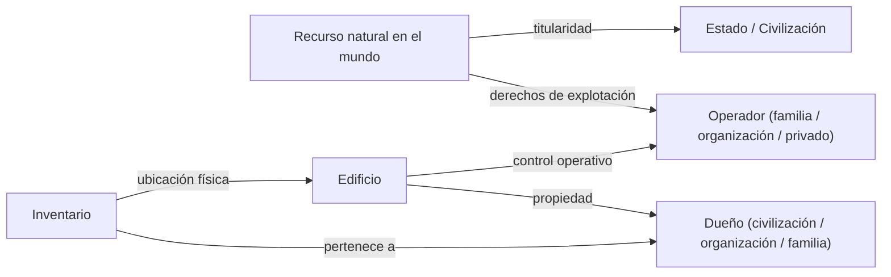
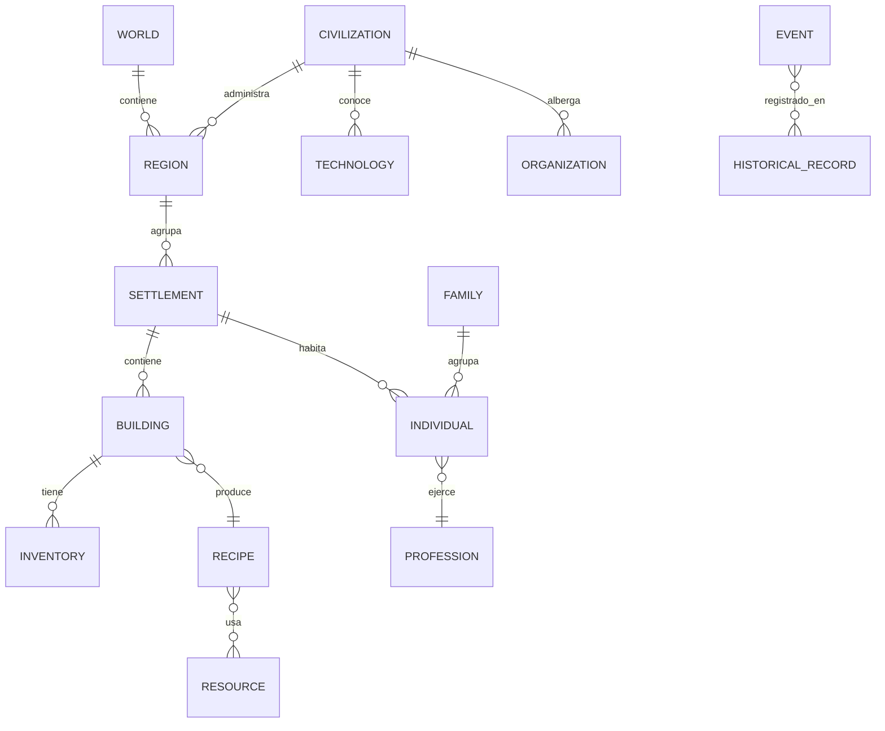

# SHARED_DATA_MODEL — Civilization Evolutions

> **Phase 2 — Modelo de datos compartido (conceptual).** Entidades centrales de la simulación, sus atributos, identidad, relaciones, quién las posee/gestiona y quién las consume. **No son structs C++ finales**: es un modelo conceptual para evitar duplicación entre sistemas. Autoridad: [GDD_Entidades_y_Relaciones](docs/01-systems/GDD_Entidades_y_Relaciones_v0.1.md) + [GDD_Recursos_y_Materiales](docs/01-systems/GDD_Recursos_y_Materiales_v0.1.md). Propiedad: ver DR-07 en [DESIGN_DECISION_REGISTER.md](DESIGN_DECISION_REGISTER.md).
> Versión 1.0 · Estado: conceptual.

## Principios del modelo

1. **Identidad única y persistente:** cada entidad tiene un identificador estable; no se referencia por nombre visible. (Entidades §2/§10; Recursos §17.)
2. **Sin duplicación:** una entidad/recurso vive en un solo lugar; los sistemas la **referencian**, no la copian. (Maestro §6.)
3. **Relaciones como datos de primera clase:** múltiples, simultáneas, con memoria histórica; cambian/desaparecen/reaparecen. (Entidades §9.)
4. **Dueño vs consumidores:** cada entidad tiene un sistema **dueño** de su comportamiento; otros **leen**.
5. **Individual ↔ agregado:** una entidad puede simularse en detalle o agregada sin perder identidad conceptual (LOD, DR-10).
6. **Propiedad en capas:** titularidad ≠ derechos de explotación ≠ propiedad del edificio ≠ control operativo ≠ ubicación del inventario (DR-07).

## Entidades centrales

Formato por entidad: **Propósito · Atributos · Identidad · Relaciones · Dueño / Consumidores · Individual o agregada · Evolución**.

### Mundo (World)
- **Propósito:** contenedor raíz del estado del mundo y sus parámetros de generación.
- **Atributos:** semilla, dimensiones, preset de mapa, parámetros de clima/geología, fecha actual.
- **Identidad:** única por partida. **Relaciones:** contiene Terreno, Regiones, Civilizaciones, Registro histórico.
- **Dueño:** Generación del Mundo (estado inicial) + Geografía (procesos). **Consumidores:** todos.
- **Escala:** agregada (singleton). **Evolución:** cambios ambientales/impacto humano a lo largo del tiempo.

### Terreno / Región geográfica
- **Propósito:** relieve, hidrología, biomas, suelo, recursos naturales de una zona.
- **Atributos:** altura, bioma, fertilidad, clima local/estacional, cuerpos de agua, yacimientos.
- **Identidad:** por celda/parcela/región geográfica. **Relaciones:** contiene recursos naturales; condiciona asentamientos y rutas.
- **Dueño:** Geografía/Medioambiente. **Consumidores:** Construcción, Economía, Producción, Logística, Exploración, Militar.
- **Escala:** agregada por región; detalle local donde haya actividad. **Evolución:** regeneración/agotamiento, erosión, deforestación (post-MVP).

### Región administrativa / Territorio
- **Propósito:** agrupación político-administrativa de asentamientos.
- **Atributos:** nombre, límites, identidad regional, nivel de autonomía, políticas/impuestos locales, especialización.
- **Identidad:** persistente. **Relaciones:** agrupa Asentamientos; pertenece a una Civilización; relaciones con otras regiones.
- **Dueño:** Administración Territorial (ligada a Política). **Consumidores:** Economía, Población, Exploración.
- **Escala:** agregada. **Evolución:** se crean/fusionan/independizan con la historia.

### Civilización
- **Propósito:** sociedad política e histórica de mayor alcance (jugador o IA).
- **Atributos:** identidad cultural/religiosa, tecnología conocida, gobierno, tesorería, relaciones diplomáticas, memoria histórica, personalidad (IA).
- **Identidad:** persistente. **Relaciones:** posee Territorios/Asentamientos; mantiene relaciones diplomáticas; afiliación cultural/religiosa.
- **Dueño:** IA y Autonomía (las no jugadoras) / el jugador (la propia). **Consumidores:** Diplomacia, Economía, Guerra, Eventos.
- **Escala:** agregada, con detalle creciente por cercanía/relevancia (IA §8). **Evolución:** nace/transforma/desaparece.

### Asentamiento (Settlement)
- **Propósito:** núcleo habitado local (aldea→ciudad).
- **Atributos:** ubicación, población, inventarios/almacenes, edificios, especialización, infraestructura, identidad.
- **Identidad:** persistente. **Relaciones:** contiene Edificios, Habitantes, Inventarios; pertenece a Región/Civilización; conectado por rutas.
- **Dueño:** compartido (Población + Economía + Construcción) bajo Entidades. **Consumidores:** casi todos.
- **Escala:** individual (chico) → agregado (grande). **Evolución:** crecimiento urbano, especialización, decadencia.

### Individuo (Habitante)
- **Propósito:** persona de la sociedad.
- **Atributos:** id, edad, sexo, familia, profesión, lugar de trabajo, necesidades, salud, habilidades, afiliación cultural/religiosa, felicidad.
- **Identidad:** persistente en escala individual; se **agrega** en grupos sobre un umbral (DR-10). **Relaciones:** miembro de Familia/Hogar; empleado en Edificio; habita Vivienda; pertenece a clase social.
- **Dueño:** Población y Sociedad. **Consumidores:** Producción (trabajo), Economía (consumo), Eventos, Cultura/Religión.
- **Escala:** individual o agregado. **Evolución:** nace, envejece, cambia de profesión/clase, migra, muere.

### Familia / Hogar
- **Propósito:** unidad social y económica básica.
- **Atributos:** miembros, linaje, vivienda, economía doméstica, estructura (según cultura/época).
- **Identidad:** persistente (linaje). **Relaciones:** agrupa Individuos; ocupa una Vivienda; herencia de propiedad (DR-07, pendiente).
- **Dueño:** Población. **Consumidores:** Economía, Cultura, Construcción (vivienda).
- **Escala:** individual (chico) / agregada. **Evolución:** se forma, crece, se divide, se extingue.

### Organización / Institución
- **Propósito:** gremios, instituciones religiosas, políticas, comerciales, educativas, militares.
- **Atributos:** tipo, miembros/representantes, propiedades, influencia, recursos.
- **Identidad:** persistente. **Relaciones:** agrupa Individuos; posee Edificios/Inventarios; influye en Política/Economía/Cultura.
- **Dueño:** el sistema de dominio (Religión/Política/Cultura/Economía) sobre el modelo de Entidades. **Consumidores:** varios.
- **Escala:** agregada. **Evolución:** surge, crece, se reforma, desaparece.

### Edificio / Construcción
- **Propósito:** estructura física con función (vivienda, producción, almacén, religioso, etc.).
- **Atributos:** id, tipo/defId, posición/orientación, estado de obra, materiales, trabajadores, almacenamiento, configuración productiva, condición/mantenimiento, propiedad, versión histórica.
- **Identidad:** persistente (conserva su historia al evolucionar). **Relaciones:** ubicado en Asentamiento/Terreno; emplea Individuos; contiene Inventario; propiedad de Civilización/Organización/Familia (DR-07).
- **Dueño:** Construcción (estructura) + Producción (función). **Consumidores:** Economía, Población, Logística, Cultura (patrimonio).
- **Escala:** individual (actor lógico, no necesariamente render). **Evolución:** obra→operativo→mejora/evolución→obsolescencia→abandono→ruina.

### Recurso natural (en el mundo)
- **Propósito:** materia prima en el terreno (bosque, roca, agua, fauna, yacimiento).
- **Atributos:** tipo (id de Recurso), cantidad, renovable/no renovable, tasa de regeneración, ubicación.
- **Identidad:** por nodo/yacimiento. **Relaciones:** pertenece a Terreno; titularidad del Estado/civilización (DR-07); explotado por Edificios/Individuos.
- **Dueño:** Geografía (existencia) + Recursos (identidad/unidad). **Consumidores:** Producción, Economía, Logística.
- **Escala:** por nodo/agregado regional. **Evolución:** se agota/regenera.

### Recurso / Material (catálogo)
- **Propósito:** definición única de un bien (identidad económica + material).
- **Atributos:** id estable, nombre visible (localizado), categoría (naturaleza) + función económica (materia prima/intermedio/final), calidad, reglas de almacenamiento/deterioro, unidad, propiedades.
- **Identidad:** id global único. **Relaciones:** usado por Recetas, Inventarios, Comercio, Construcción.
- **Dueño:** **Recursos y Materiales** (catálogo único). **Consumidores:** TODOS los económicos.
- **Escala:** definición (data-driven). **Evolución:** disponibilidad por período/tecnología.

### Inventario
- **Propósito:** contenedor de cantidades de recursos en una ubicación.
- **Atributos:** dueño (edificio/asentamiento/organización/familia), capacidad, contenidos {recurso→cantidad}, ubicación física.
- **Identidad:** por contenedor. **Relaciones:** pertenece a una entidad; la **ubicación física** importa (no se consume sin entrega — DC-06).
- **Dueño:** Recursos/Logística. **Consumidores:** Producción, Economía, Comercio.
- **Escala:** individual. **Evolución:** flujos de entrada/salida.

### Receta de producción
- **Propósito:** transformación entradas→salidas.
- **Atributos:** id, insumos, productos, duración, tipo de edificio requerido, requisitos de mano de obra, recetas alternativas, requisito tecnológico.
- **Identidad:** definición (data-driven). **Relaciones:** usada por Edificios; referencia Recursos; habilitada por Tecnología.
- **Dueño:** Producción y Trabajo. **Consumidores:** Economía, Logística.
- **Escala:** definición. **Evolución:** nuevas recetas/mejoras por tecnología.

### Profesión / Trabajo
- **Propósito:** ocupación de un individuo y sus habilidades.
- **Atributos:** tipo, habilidad principal + secundarias, nivel/experiencia, lugar de trabajo.
- **Dueño:** Producción (empleo) + Población (habilidades). **Consumidores:** Economía (salarios).
- **Escala:** individual/agregada. **Evolución:** aprendizaje, cambio de profesión, especialización.

### Tecnología / Conocimiento
- **Propósito:** capacidad/conocimiento que habilita métodos y transformaciones.
- **Atributos:** id, disciplina, prerrequisitos (condiciones, no año), efectos habilitados, estado (descubierta/en progreso).
- **Identidad:** definición + estado por civilización. **Relaciones:** habilita Recetas/Edificios/Infraestructura/Unidades; se difunde entre Civilizaciones.
- **Dueño:** Tecnología. **Consumidores:** Producción, Construcción, Logística, Militar. (Marco común: HISTORICAL_EVOLUTION_FRAMEWORK.)
- **Escala:** por civilización. **Evolución:** se descubre; rara vez se pierde; coexiste con lo obsoleto.

### Cultura / Religión
- **Propósito:** identidad y creencias de una sociedad.
- **Atributos:** componentes (idioma, arte, tradiciones, festividades / creencias, instituciones, figuras), difusión, variantes regionales.
- **Identidad:** persistente por civilización/región. **Relaciones:** afiliación de Individuos; expresión en Edificios; influye Política.
- **Dueño:** Cultura / Religión. **Consumidores:** Población, Construcción, Diplomacia, Política.
- **Escala:** agregada. **Evolución:** orgánica; fusión, división, secularización.

### Institución política / Gobierno
- **Propósito:** estructura de poder, leyes y políticas.
- **Atributos:** forma de gobierno, leyes/políticas activas, instituciones, líderes, estabilidad.
- **Dueño:** Política y Gobierno (aplicada por Administración). **Consumidores:** Economía (impuestos), Población, Militar.
- **Escala:** agregada por civilización/región. **Evolución:** reformas, cambios de régimen con consecuencias.

### Ruta comercial / de transporte
- **Propósito:** conexión física para mover recursos/personas.
- **Atributos:** origen/destino, modo (terrestre/fluvial/marítimo), capacidad, costo/tiempo, estado, mantenimiento.
- **Dueño:** Transporte/Comercio/Logística. **Consumidores:** Economía, Militar (abastecimiento), Exploración.
- **Escala:** individual/agregada. **Evolución:** se crean/optimizan/abandonan.

### Evento / Acontecimiento
- **Propósito:** hecho con causas y consecuencias, base de la historia emergente.
- **Atributos:** tipo, fecha, escala, entidades involucradas, causas, consecuencias (inmediatas/largo plazo).
- **Dueño:** generado por el sistema de dominio; **registrado** por Eventos. **Consumidores:** Progresión (legado), UI (notificaciones/crónica).
- **Escala:** individual. **Evolución:** encadena consecuencias.

### Registro histórico / Memoria
- **Propósito:** cronología y biografías verificables.
- **Atributos:** entradas con fecha/entidades/consecuencias; biografías de figuras importantes; huellas en el mundo.
- **Dueño:** Eventos. **Consumidores:** Progresión, Interfaz, Diplomacia (memoria de relaciones).
- **Escala:** agregada. **Evolución:** crece durante la partida.

## Modelo de propiedad (DR-07, en capas)

Distinguir estas cinco capas evita duplicar "propiedad" en cada sistema y habilita fiscalidad, herencia y comercio coherentes (pendiente de confirmación: DR-07).

## Diagrama de relaciones (alto nivel)

## Notas de duplicación a evitar

- **Recurso/material:** solo en el catálogo de Recursos; el resto referencia por id. (F-09)
- **Identidad/relaciones:** solo en Entidades; Población añade dinámica social, no otra identidad. (F-10)
- **Control territorial:** Exploración (conocimiento/ocupación) ≠ Administración (gestión) ≠ Diplomacia (relación externa). (F-11)
- **Inventario:** una ubicación física por contenedor; no replicar stock entre sistemas. (DC-07/DC-06)
