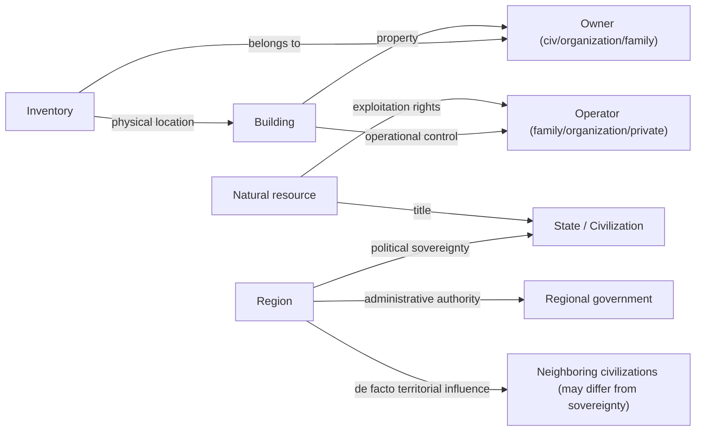
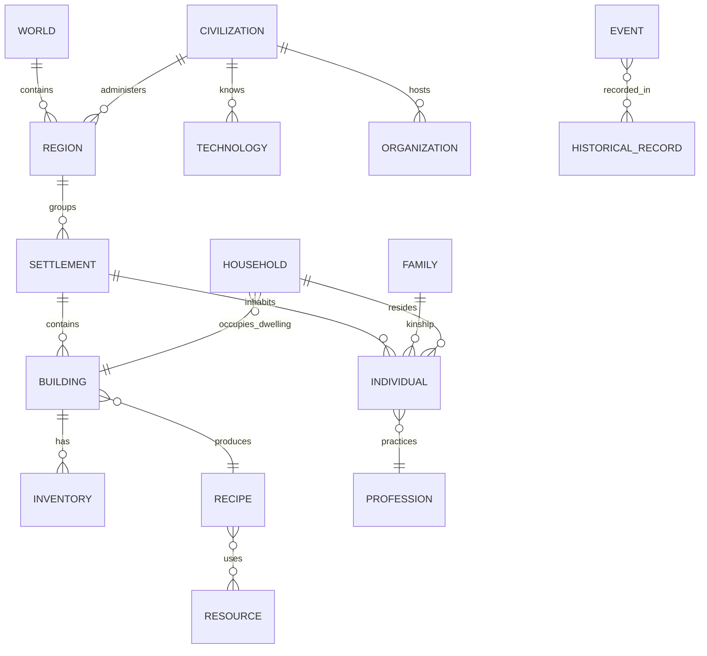

# SHARED_DATA_MODEL — Civilization Evolutions

> **Phase 2 — Shared data model (conceptual).** Central simulation entities, their attributes, identity, relationships, who owns/manages them and who consumes them. **These are not final C++ structs**: it is a conceptual model to avoid duplication between systems. Authority: [GDD_Entities_and_Relationships](docs/01-systems/GDD_Entities_and_Relationships_v0.1.md) + [GDD_Resources_and_Materials](docs/01-systems/GDD_Resources_and_Materials_v0.1.md). Property: see DR-07 in [DESIGN_DECISION_REGISTER.md](DESIGN_DECISION_REGISTER.md).
> Version 1.1 · Last updated 2026-11-04 · Status: conceptual.

## Model principles

1. **Single, persistent identity:** each entity has a stable identifier; it is not referenced by its visible name. (Entities §2/§10; Resources §17.)
2. **No duplication:** an entity/resource lives in a single place; systems **reference** it, they do not copy it. (Maestro §6.)
3. **Relationships as first-class data:** multiple, simultaneous, with historical memory; they change/disappear/reappear. (Entities §9.)
4. **Owner vs consumers:** each entity has an **owner** system for its behavior; others **read**.
5. **Individual ↔ aggregate:** an entity can be simulated in detail or aggregated without losing conceptual identity (LOD, DR-10).
6. **Layered property:** title ≠ exploitation rights ≠ building property ≠ operational control ≠ inventory location ≠ **administrative authority** ≠ **political sovereignty** ≠ **territorial influence** (DR-07; see § Property model).
7. **Family ≠ Household:** the **family/lineage** is kinship and inheritance (it can span several households and settlements); the **household** is the unit of residence/domestic economy that occupies **one** dwelling. An individual belongs to a family even if they live in another household.
8. **Persistence under aggregation:** when moving from individual to aggregate (DR-10), the identity/history is preserved; the dynamic is averaged/summarized. See § Persistence of aggregation.

## Central entities

Format per entity: **Purpose · Attributes · Identity · Relationships · Owner / Consumers · Individual or aggregate · Evolution**.

### World
- **Purpose:** root container of the world state and its generation parameters.
- **Attributes:** seed, dimensions, map preset, climate/geology parameters, current date.
- **Identity:** unique per game. **Relationships:** contains Terrain, Regions, Civilizations, Historical record.
- **Owner:** World Generation (initial state) + Geography (processes). **Consumers:** all.
- **Scale:** aggregate (singleton). **Evolution:** environmental changes/human impact over time.

### Terrain / Geographic region
- **Purpose:** relief, hydrology, biomes, soil, natural resources of a zone.
- **Attributes:** height, biome, fertility, local/seasonal climate, water bodies, deposits.
- **Identity:** per cell/plot/geographic region. **Relationships:** contains natural resources; conditions settlements and routes.
- **Owner:** Geography/Environment. **Consumers:** Construction, Economy, Production, Logistics, Exploration, Military.
- **Scale:** aggregate per region; local detail where there is activity. **Evolution:** regeneration/depletion, erosion, deforestation (post-MVP).

### Administrative region / Territory
- **Purpose:** political-administrative grouping of settlements.
- **Attributes:** name, boundaries, regional identity, level of autonomy, local policies/taxes, specialization.
- **Identity:** persistent. **Relationships:** groups Settlements; belongs to a Civilization; relationships with other regions.
- **Owner:** Territorial Administration (tied to Politics). **Consumers:** Economy, Population, Exploration.
- **Scale:** aggregate. **Evolution:** they are created/merged/made independent with history.

### Civilization
- **Purpose:** the political and historical society of the widest reach (player or AI).
- **Attributes:** cultural/religious identity, known technology, government, treasury, diplomatic relations, historical memory, personality (AI).
- **Identity:** persistent. **Relationships:** owns Territories/Settlements; maintains diplomatic relations; cultural/religious affiliation.
- **Owner:** AI and Autonomy (the non-player ones) / the player (their own). **Consumers:** Diplomacy, Economy, War, Events.
- **Scale:** aggregate, with increasing detail by proximity/relevance (AI §8). **Evolution:** born/transformed/disappeared.

### Settlement
- **Purpose:** a local inhabited nucleus (village→city).
- **Attributes:** location, population, inventories/storehouses, buildings, specialization, infrastructure, identity.
- **Identity:** persistent. **Relationships:** contains Buildings, Inhabitants, Inventories; belongs to a Region/Civilization; connected by routes.
- **Owner:** shared (Population + Economy + Construction) under Entities. **Consumers:** almost all.
- **Scale:** individual (small) → aggregate (large). **Evolution:** urban growth, specialization, decline.

### Individual (Inhabitant)
- **Purpose:** a person of the society.
- **Attributes:** id, age, sex, family, profession, workplace, needs, health, skills, cultural/religious affiliation, happiness.
- **Identity:** persistent at the individual scale; it is **aggregated** into groups above a threshold (DR-10). **Relationships:** member of a Family/Household; employed in a Building; inhabits a Dwelling; belongs to a social class.
- **Owner:** Population and Society. **Consumers:** Production (labor), Economy (consumption), Events, Culture/Religion.
- **Scale:** individual or aggregate. **Evolution:** born, ages, changes profession/class, migrates, dies.

### Family / Lineage (kinship)
- **Purpose:** kinship network and vehicle of **inheritance** and identity across generations. It is **not** a residence unit.
- **Attributes:** lineage id, members (living and deceased), kinship relations, surname/house (if the culture uses it), inheritable assets, prestige/status.
- **Identity:** persistent across generations (survives the death of members). **Relationships:** groups Individuals (who may live in different households); inheritance of property between members (DR-07); can span several Settlements.
- **Owner:** Population (with Entities for identity/relationships). **Consumers:** Economy (inheritance), Culture, Politics (dynasties).
- **Scale:** individual (small) / aggregate (irrelevant lineages are summarized). **Evolution:** born, branches out, becomes extinct; the lineage endures even as households change.

### Household
- **Purpose:** the unit of **residence and domestic economy**: who lives and consumes together in a dwelling.
- **Attributes:** current members (from one or several families), occupied dwelling, domestic economy (income/consumption), structure (according to culture/era).
- **Identity:** persistent while it exists; less durable than the lineage. **Relationships:** occupies **one** Dwelling; groups Individuals (who additionally belong to their Family/Families); the base unit of consumption/housing.
- **Owner:** Population. **Consumers:** Economy (consumption/housing), Construction (housing demand), Logistics (delivery of goods).
- **Scale:** individual (small) / aggregate. **Evolution:** forms (marriage/migration), grows, splits, dissolves.

> **Why separate them:** it allows migration and domestic service (an individual of family A lives in household B), inheritance across households, and lets demographics (lineage) and housing demand (household) scale with different rules without duplicating the Individual.

### Organization / Institution
- **Purpose:** guilds, religious, political, commercial, educational, military institutions.
- **Attributes:** type, members/representatives, properties, influence, resources.
- **Identity:** persistent. **Relationships:** groups Individuals; owns Buildings/Inventories; influences Politics/Economy/Culture.
- **Owner:** the domain system (Religion/Politics/Culture/Economy) over the Entities model. **Consumers:** several.
- **Scale:** aggregate. **Evolution:** emerges, grows, reforms, disappears.

### Building / Construction
- **Purpose:** a physical structure with a function (dwelling, production, storehouse, religious, etc.).
- **Attributes:** id, type/defId, position/orientation, construction state, materials, workers, storage, production configuration, condition/maintenance, property, historical version.
- **Identity:** persistent (it preserves its history as it evolves). **Relationships:** located in a Settlement/Terrain; employs Individuals; contains an Inventory; property of a Civilization/Organization/Family (DR-07).
- **Owner:** Construction (structure) + Production (function). **Consumers:** Economy, Population, Logistics, Culture (heritage).
- **Scale:** individual (logical actor, not necessarily render). **Evolution:** construction work→operational→upgrade/evolution→obsolescence→abandonment→ruin.

### Natural resource (in the world)
- **Purpose:** raw material in the terrain (forest, rock, water, fauna, deposit).
- **Attributes:** type (Resource id), quantity, renewable/non-renewable, regeneration rate, location.
- **Identity:** per node/deposit. **Relationships:** belongs to Terrain; title of the State/civilization (DR-07); exploited by Buildings/Individuals.
- **Owner:** Geography (existence) + Resources (identity/unit). **Consumers:** Production, Economy, Logistics.
- **Scale:** per node/regional aggregate. **Evolution:** depletes/regenerates.

### Resource / Material (catalog)
- **Purpose:** the single definition of a good (economic identity + material).
- **Attributes:** stable id, visible name (localized), category (nature) + economic function (raw material/intermediate/final), quality, storage/decay rules, unit, properties.
- **Identity:** globally unique id. **Relationships:** used by Recipes, Inventories, Trade, Construction.
- **Owner:** **Resources and Materials** (single catalog). **Consumers:** ALL the economic ones.
- **Scale:** definition (data-driven). **Evolution:** availability by period/technology.

### Inventory
- **Purpose:** a container of resource quantities at a location.
- **Attributes:** owner (building/settlement/organization/family), capacity, contents {resource→quantity}, physical location.
- **Identity:** per container. **Relationships:** belongs to an entity; the **physical location** matters (nothing is consumed without delivery — DC-06).
- **Owner:** Resources/Logistics. **Consumers:** Production, Economy, Trade.
- **Scale:** individual. **Evolution:** inflow/outflow.

### Production recipe
- **Purpose:** inputs→outputs transformation.
- **Attributes:** id, inputs, products, duration, required building type, labor requirements, alternative recipes, technology requirement.
- **Identity:** definition (data-driven). **Relationships:** used by Buildings; references Resources; enabled by Technology.
- **Owner:** Production and Labor. **Consumers:** Economy, Logistics.
- **Scale:** definition. **Evolution:** new recipes/improvements by technology.

### Profession / Labor
- **Purpose:** an individual's occupation and their skills.
- **Attributes:** type, primary + secondary skill, level/experience, workplace.
- **Owner:** Production (employment) + Population (skills). **Consumers:** Economy (wages).
- **Scale:** individual/aggregate. **Evolution:** learning, change of profession, specialization.

### Technology / Knowledge
- **Purpose:** a capability/knowledge that enables methods and transformations.
- **Attributes:** id, discipline, prerequisites (conditions, not year), enabled effects, state (discovered/in progress).
- **Identity:** definition + state per civilization. **Relationships:** enables Recipes/Buildings/Infrastructure/Units; diffuses between Civilizations.
- **Owner:** Technology. **Consumers:** Production, Construction, Logistics, Military. (Shared framework: HISTORICAL_EVOLUTION_FRAMEWORK.)
- **Scale:** per civilization. **Evolution:** it is discovered; rarely lost; coexists with the obsolete.

### Culture / Religion
- **Purpose:** the identity and beliefs of a society.
- **Attributes:** components (language, art, traditions, festivities / beliefs, institutions, figures), diffusion, regional variants.
- **Identity:** persistent per civilization/region. **Relationships:** affiliation of Individuals; expression in Buildings; influences Politics.
- **Owner:** Culture / Religion. **Consumers:** Population, Construction, Diplomacy, Politics.
- **Scale:** aggregate. **Evolution:** organic; fusion, division, secularization.

### Political institution / Government
- **Purpose:** the structure of power, laws and policies.
- **Attributes:** form of government, active laws/policies, institutions, leaders, stability.
- **Owner:** Politics and Government (applied by Administration). **Consumers:** Economy (taxes), Population, Military.
- **Scale:** aggregate per civilization/region. **Evolution:** reforms, regime changes with consequences.

### Trade / transport route
- **Purpose:** a physical connection to move resources/people.
- **Attributes:** origin/destination, mode (land/river/sea), capacity, cost/time, state, maintenance.
- **Owner:** Transport/Trade/Logistics. **Consumers:** Economy, Military (supply), Exploration.
- **Scale:** individual/aggregate. **Evolution:** created/optimized/abandoned.

### Event / Occurrence
- **Purpose:** a fact with causes and consequences, the basis of emergent history.
- **Attributes:** type, date, scale, entities involved, causes, consequences (immediate/long-term).
- **Owner:** generated by the domain system; **recorded** by Events. **Consumers:** Progression (legacy), UI (notifications/chronicle).
- **Scale:** individual. **Evolution:** chains consequences.

### Historical record / Memory
- **Purpose:** verifiable chronology and biographies.
- **Attributes:** entries with date/entities/consequences; biographies of important figures; imprints on the world.
- **Owner:** Events. **Consumers:** Progression, Interface, Diplomacy (relationship memory).
- **Scale:** aggregate. **Evolution:** grows during the game.

## Property and authority model (DR-07, layered)

Eight distinct layers, which must **not** be collapsed into a single "owner" field:

| Layer | What it expresses | Example | Owner system |
|---|---|---|---|
| **Title** | who is the legal owner of the resource/land | the State owns the forest | Economy/Politics |
| **Exploitation rights** | who may extract/use | a family logs under license | Economy |
| **Building property** | who owns the structure | guild owns the workshop | Construction/Economy |
| **Operational control** | who operates it day to day | foreman/workers | Production |
| **Inventory location** | where the goods physically are | the workshop's storehouse | Resources/Logistics |
| **Administrative authority** | who manages/collects locally | the region's governor | Territorial Administration |
| **Political sovereignty** | under which sovereign power it falls | the State the region belongs to | Politics and Government |
| **Territorial influence** | de facto reach (cultural/economic/military), not legal | disputed zone of influence | Exploration/Diplomacy |

Distinguishing these layers avoids duplicating "property" in each system and enables taxation, inheritance, trade, regional autonomy and disputed zones of influence coherently. **Sovereignty ≠ influence:** a region may be sovereign to one civilization and under the economic/cultural influence of another (the basis for vassalage, gray zones and conflict). DR-07 **confirmed by delegation** (reversible).

## Persistence of aggregation (individual ↔ aggregate, DR-10)

When crossing the aggregation threshold (DR-10/DR-06), an entity stops being simulated in detail but does **not** lose identity. What is preserved and what is summarized:

| **Preserved** (identity/history) | **Summarized/averaged** (dynamic) | Can be **reconstructed** when disaggregating |
|---|---|---|
| stable id of the entity and of its key relationships | individual needs/health/happiness → averages and distribution | representative individuals from the distribution |
| lineage and relevant historical figures | exact positions → density by zone | households from average size and available housing |
| cultural/religious affiliation and class (proportions) | individual inventories → the settlement's aggregate stock | professions from the occupational mix |
| already-recorded facts/events | ongoing tasks/journeys → production rates | — |

**Rules:** (1) aggregation is **reversible** without inventing history (what was summarized regenerates plausibly, not identically); (2) the state is never duplicated: an entity is in individual **or** aggregate mode, not both; (3) already-recorded events remain even if their protagonists are aggregated (it supports Scenario G of [CROSS_SYSTEM_VALIDATION_SCENARIOS.md](CROSS_SYSTEM_VALIDATION_SCENARIOS.md)). Concrete thresholds and budgets: pending per stage (DR-06).

## Scope per entity (MVP vs future)

| Entity | In the MVP/first playable? | Note |
|---|---|---|
| World, Terrain/Geographic region | **MVP** | base of everything |
| Settlement | **MVP** | one at the start |
| Individual | **MVP** | ~20–30 individual |
| Household | **MVP (basic)** | housing/consumption |
| Family/Lineage | **Minimal MVP** | full inheritance → future |
| Building, Inventory, Natural resource, Resource/Material, Recipe, Profession | **MVP** | the heart of the economy (Scenarios A–B) |
| Technology/Knowledge | **MVP (initial tree)** | diffusion between civilizations → future |
| Administrative region | Future | appears with several cities (Scenario E) |
| Civilization (AI) | Future | the player's own, minimal in MVP; other AIs → future |
| Organization/Institution | Future | guilds/religion later |
| Culture/Religion | Future | Scenario F |
| Political institution/Government | Future | after regional administration |
| Trade route | **MVP (intra-settlement)** / Future (inter) | simple logistics already exists in SimCore |
| Event/Historical record | **MVP (basic)** | minimal chronicle; biographies → future |

## Relationship diagram (high level)

## Duplication notes to avoid

- **Resource/material:** only in the Resources catalog; the rest reference it by id. (F-09)
- **Identity/relationships:** only in Entities; Population adds social dynamics, not another identity. (F-10)
- **Territorial control:** Exploration (knowledge/occupation) ≠ Administration (management) ≠ Diplomacy (external relationship). (F-11)
- **Inventory:** one physical location per container; do not replicate stock between systems. (DC-07/DC-06)
