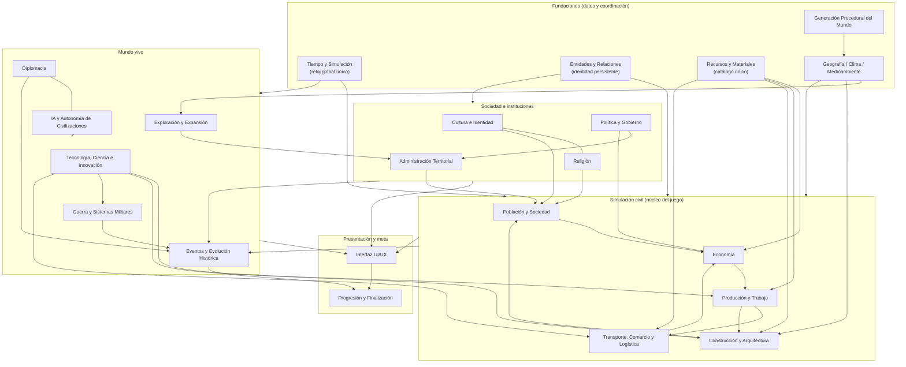
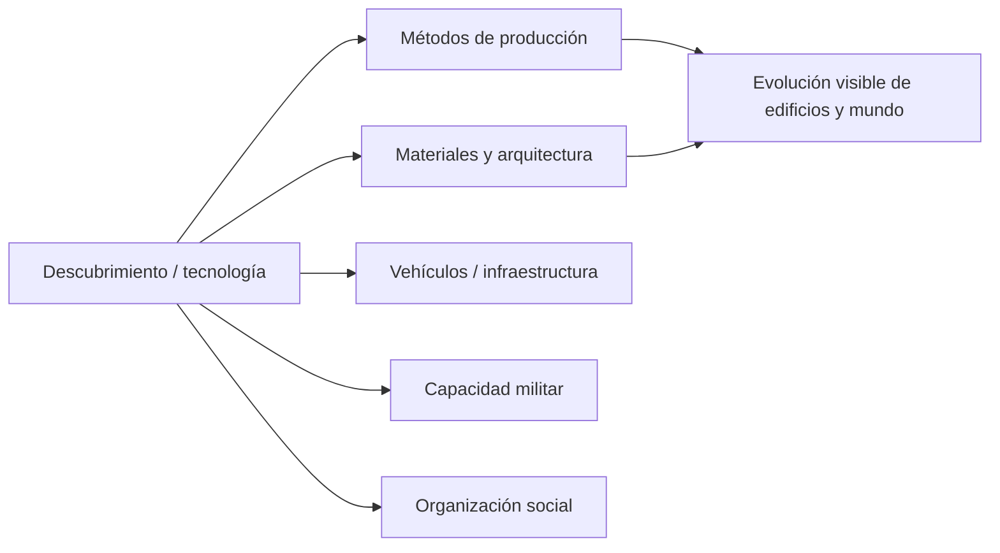
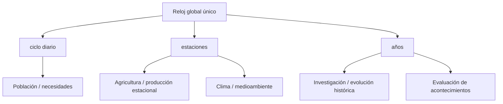

# SYSTEM_ARCHITECTURE_MAP — Civilization Evolutions

> Mapa **conceptual** de la arquitectura de juego: sistemas, responsabilidades, relaciones, entidades compartidas y flujos principales. No es una especificación técnica final. Fuente de contratos: [GDD_MAESTRO §5–6](docs/00-project/GDD_MAESTRO.md); detalle por dominio en los GDD de sistema (ver [DOCUMENTATION_INDEX.md](DOCUMENTATION_INDEX.md)).

## Principio rector

El mundo se simula como **un sistema coherente**, no como features sueltas. Los sistemas comparten **entidades y recursos con identidad única**, se coordinan por un **reloj común** y se comunican por **eventos**, sin que cada sistema conozca la implementación interna de los demás. La **lógica de simulación** (reglas) se mantiene **separada de la presentación** (render/UI).

## Capas conceptuales

(Las flechas indican "provee datos / habilita / condiciona"; las líneas `---` son relaciones bidireccionales fuertes.)

## Responsabilidades (dueño de cada decisión)

| Sistema | Responsabilidad (de qué es autoridad) |
|---|---|
| **Tiempo y Simulación** | Reloj global único, calendario, velocidades, ciclos internos de distinta frecuencia. Coordina a todos. |
| **Entidades y Relaciones** | Identidad persistente y relaciones de habitantes, familias, edificios, asentamientos, regiones y organizaciones. Base compartida. |
| **Recursos y Materiales** | Catálogo e inventarios únicos, unidades, moneda, calidad/deterioro/almacenamiento. |
| **Geografía/Clima/Medioambiente** | Estado y procesos naturales: relieve, hidrología, biomas, clima, recursos naturales, flora/fauna, desastres. |
| **Generación del Mundo** | Estado inicial procedural del mapa + editor. Consume el modelo climático/recursos. |
| **Población y Sociedad** | Dinámica demográfica y social: individuos, familias, clases, necesidades, salud, educación, migración. |
| **Economía** | Propiedad, precios, mercados, consumo, moneda, tesorería, impuestos. |
| **Producción y Trabajo** | Edificios productivos, recetas, productividad, empleo, calidad, evolución funcional/visual de edificios. |
| **Transporte/Comercio/Logística** | Movimiento físico de recursos, rutas, infraestructura, mercados físicos, comercio. |
| **Construcción y Arquitectura** | Obra, materiales constructivos, urbanismo, arquitectura, patrimonio, soporte físico. |
| **Cultura / Religión / Política / Administración** | Identidad y prácticas / creencias e instituciones espirituales / poder, leyes, instituciones / organización territorial. |
| **Tecnología** | Conocimiento e invenciones que habilitan métodos y cambian capacidades (sin adopción automática). |
| **Exploración** | Adquisición y circulación del conocimiento espacial; ocupación/colonización. |
| **Diplomacia / IA / Guerra** | Relaciones y tratados / decisiones autónomas de civilizaciones / conflicto armado. |
| **Eventos** | Registra hechos producidos por los sistemas dueños; memoria y cronología. No crea efectos sin regla propietaria. |
| **Interfaz / Progresión** | Presenta estado y órdenes (no es autoridad de reglas) / objetivos, puntuación y finalización opcionales. |

## Entidades y datos compartidos (no duplicar)

- **Recurso/material:** un identificador e inventario común, usado por Economía, Producción, Construcción, Logística, Comercio, Tecnología, Guerra. (Dueño: Recursos y Materiales.)
- **Entidad del mundo** (habitante, familia, edificio, asentamiento, región, organización): identidad persistente e historial compartidos. (Dueño: Entidades y Relaciones.)
- **Reloj/fecha:** única fuente temporal para todos los ciclos. (Dueño: Tiempo.)
- **Conocimiento/tecnología:** habilita capacidades en varios dominios; disponibilidad ≠ adopción. (Dueño: Tecnología.)
- **Registro histórico:** hechos verificables emitidos por los sistemas dueños. (Dueño: Eventos.)

## Flujos principales

**1. Cadena productiva + logística + consumo**

Regla: **nada se consume en destino si no fue entregado físicamente** (logística real, simplificada).

**2. Tecnología como disparador transversal**

Regla: la tecnología **habilita**; la adopción y sus reglas pertenecen a cada dominio.

**3. El tiempo como eje de coordinación**

## Reglas de integración (del Maestro §6)

- La **interfaz** presenta, no decide; las notificaciones nacen de cambios simulados.
- **Eventos** consume hechos reales; no inventa efectos.
- **Recursos** no se copian por sistema; identidad única.
- **Población** agregada debe mantener coherencia con la población total.
- La **disponibilidad** tecnológica no implica adopción automática.
- Ningún sistema impone una **cronología histórica obligatoria**.

> Para el estado de qué está implementado de este mapa, ver [IMPLEMENTATION_ALIGNMENT.md](IMPLEMENTATION_ALIGNMENT.md).
