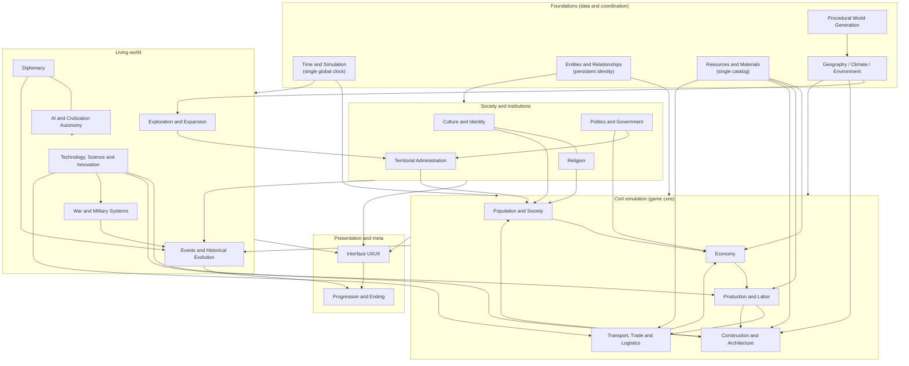
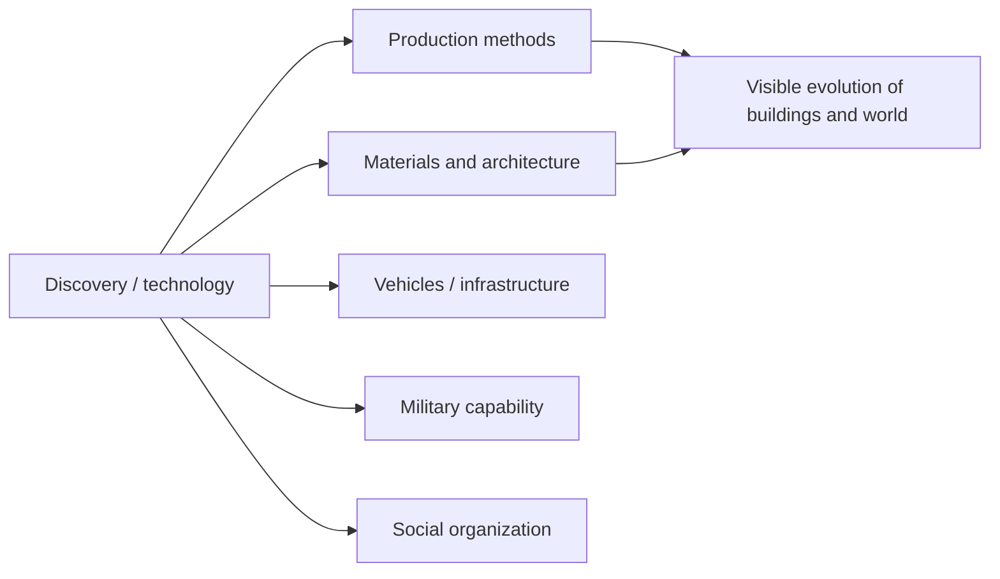
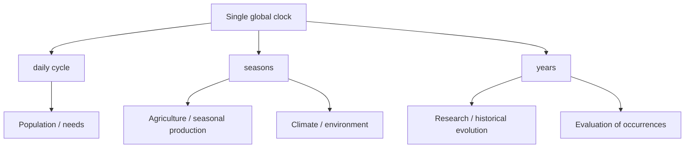

# SYSTEM_ARCHITECTURE_MAP — Civilization Evolutions

> **Conceptual** map of the game architecture: systems, responsibilities, relationships, shared entities and main flows. It is not a final technical specification. Source of contracts: [GDD_MASTER §5–6](docs/00-project/GDD_MASTER.md); detail per domain in the system GDDs (see [DOCUMENTATION_INDEX.md](DOCUMENTATION_INDEX.md)).

## Guiding principle

The world is simulated as **one coherent system**, not as loose features. The systems share **entities and resources with a single identity**, coordinate through a **shared clock** and communicate through **events**, without each system knowing the internal implementation of the others. The **simulation logic** (rules) is kept **separate from presentation** (render/UI).

## Conceptual layers

(The arrows indicate "provides data / enables / conditions"; the `---` lines are strong bidirectional relationships.)

## Responsibilities (owner of each decision)

| System | Responsibility (what it is the authority of) |
|---|---|
| **Time and Simulation** | Single global clock, calendar, speeds, internal cycles of different frequency. Coordinates everyone. |
| **Entities and Relationships** | Persistent identity and relationships of inhabitants, families, buildings, settlements, regions and organizations. Shared base. |
| **Resources and Materials** | Single catalog and inventories, units, currency, quality/decay/storage. |
| **Geography/Climate/Environment** | State and natural processes: relief, hydrology, biomes, climate, natural resources, flora/fauna, disasters. |
| **World Generation** | Initial procedural state of the map + editor. Consumes the climate/resource model. |
| **Population and Society** | Demographic and social dynamics: individuals, families, classes, needs, health, education, migration. |
| **Economy** | Property, prices, markets, consumption, currency, treasury, taxes. |
| **Production and Labor** | Productive buildings, recipes, productivity, employment, quality, functional/visual evolution of buildings. |
| **Transport/Trade/Logistics** | Physical movement of resources, routes, infrastructure, physical markets, trade. |
| **Construction and Architecture** | Construction work, building materials, urban planning, architecture, heritage, physical support. |
| **Culture / Religion / Politics / Administration** | Identity and practices / beliefs and spiritual institutions / power, laws, institutions / territorial organization. |
| **Technology** | Knowledge and inventions that enable methods and change capabilities (without automatic adoption). |
| **Exploration** | Acquisition and circulation of spatial knowledge; occupation/colonization. |
| **Diplomacy / AI / War** | Relationships and treaties / autonomous decisions of civilizations / armed conflict. |
| **Events** | Records facts produced by the owner systems; memory and chronology. Does not create effects without an owning rule. |
| **Interface / Progression** | Presents state and orders (not a rules authority) / objectives, scoring and optional endings. |

## Shared entities and data (do not duplicate)

- **Resource/material:** a single identifier and shared inventory, used by Economy, Production, Construction, Logistics, Trade, Technology, War. (Owner: Resources and Materials.)
- **World entity** (inhabitant, family, building, settlement, region, organization): shared persistent identity and history. (Owner: Entities and Relationships.)
- **Clock/date:** a single temporal source for all cycles. (Owner: Time.)
- **Knowledge/technology:** enables capabilities across several domains; availability ≠ adoption. (Owner: Technology.)
- **Historical record:** verifiable facts emitted by the owner systems. (Owner: Events.)

## Main flows

**1. Production chain + logistics + consumption**

Rule: **nothing is consumed at the destination unless it was physically delivered** (real logistics, simplified).

**2. Technology as a cross-cutting trigger**

Rule: technology **enables**; adoption and its rules belong to each domain.

**3. Time as the coordination axis**

## Integration rules (from the Maestro §6)

- The **interface** presents, it does not decide; notifications arise from simulated changes.
- **Events** consumes real facts; it does not invent effects.
- **Resources** are not copied per system; single identity.
- Aggregate **Population** must stay coherent with the total population.
- Technological **availability** does not imply automatic adoption.
- No system imposes a **mandatory historical chronology**.

> For the status of what has been implemented of this map, see [IMPLEMENTATION_ALIGNMENT.md](IMPLEMENTATION_ALIGNMENT.md).
