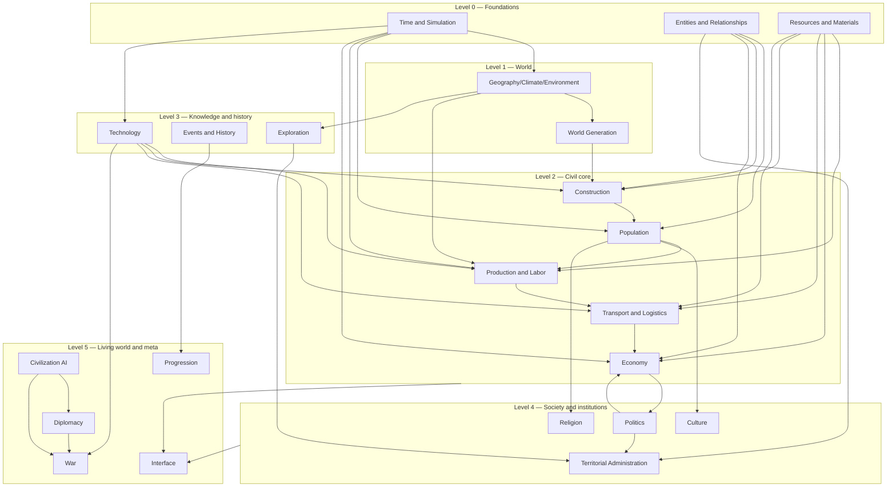
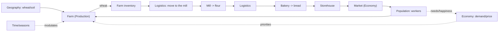

# SYSTEM_DEPENDENCY_MAP — Civilization Evolutions

> **Phase 2 — Map of dependencies and interaction between systems.** Which systems must exist before others, how information flows, how events propagate and what update cadence each one needs. Sources: Maestro §6, the GDD data sheets (see [DOCUMENTATION_INDEX.md](DOCUMENTATION_INDEX.md)). Complements [SYSTEM_ARCHITECTURE_MAP.md](SYSTEM_ARCHITECTURE_MAP.md).
> Version 1.1 · Last updated 2026-11-04 · Status: conceptual.

## A. Dependency graph (reliable implementation order)

A system **must** exist before another if the second cannot work without it.

**How to read it:** implement from the bottom up. **Level 0** (Time, Entities, Resources) is a prerequisite of almost everything. The playable prototype lives in Levels 0–3 (see [DEVELOPMENT_ROADMAP.md](DEVELOPMENT_ROADMAP.md)).

## A.2 System classification and authoritative data owner

> **Class:** *Foundational* = base that almost everything depends on; *Core* = heart of the civil simulation and of the first playable; *Supporting* = enriches the core, not essential for the MVP; *Advanced* = living world/meta, late stages; *Cross-cutting* = touches everyone (does not fit in a level).
> **Does it operate independently in early development?** = whether it can be developed and tested in isolation (with minimal stubs) before integrating the rest. Useful for parallelizing.
> **Authoritative data owner** = single source of truth; the others **read** (do not copy). Aligns with [SHARED_DATA_MODEL.md](SHARED_DATA_MODEL.md).

| System | Class | Operates independently early? | Data it is the **authoritative owner** of |
|---|---|---|---|
| Time | **Foundational** | **Yes** (pure clock, already in SimCore) | date/season/speed, cadences |
| Entities and Relationships | **Foundational** | **Yes** (pure identity/relationships) | stable id and relationships of every entity |
| Resources and Materials | **Foundational** | **Yes** (catalog + inventories) | catalog of resources/materials and inventories |
| Geography/Climate | Foundational (world) | Partial (needs Time) | terrain, biomes, climate, existence of natural resources |
| World Generation | Supporting | **Yes** (generates to file/state) | initial state of the world (seed, layout) |
| Construction | **Core** | Partial (needs Resources/Entities) | physical structures and their construction/evolution state |
| Population | **Core** | Partial (needs Entities/Time) | individuals, households, lineages, demographics |
| Production and Labor | **Core** | Partial (needs Resources/Population) | recipes, work assignment, transformation |
| Transport and Logistics | **Core** | Partial (needs Resources/Geography) | routes, physical movement of goods |
| Economy | **Core** | No (integrates several) | prices, markets, currency, taxation |
| Technology | **Core** (enabler) | **Yes** (pure tree/conditions) | state of knowledge per civilization |
| Events and History | Cross-cutting | **Yes** (bus + record) | chronicle/historical record (does not originate effects) |
| Exploration/Expansion | Supporting | Partial | territorial knowledge and occupation |
| Culture | Supporting | Partial (needs Population) | cultural identity, practices, diffusion |
| Religion | Supporting | Partial (needs Population) | beliefs, religious institutions |
| Politics and Government | Supporting | No | form of government, laws/policies, sovereignty |
| Territorial Administration | Supporting | No | administrative regions, local authority/taxes |
| Diplomacy | Advanced | No | relationships/treaties between civilizations |
| Civilization AI | Advanced | No (consumes almost everyone) | decisions and personality of the non-player ones |
| War | Advanced | No | military forces, fortifications, conflict |
| Progression | Advanced (meta) | **Yes** (reads indicators) | objectives, legacy, ending conditions |
| Interface | Cross-cutting | **Yes** (reads everything, writes no sim) | nothing of the simulation (presentation only) |

**Candidates to parallelize right away** (they operate independently): Time, Entities, Resources, Technology, Events, Progression, Interface. These are the ones a fork can advance with stubs without blocking the core.

## B. Dependencies per system

| System | Required foundationals | Direct | Influences | Consumes info from |
|---|---|---|---|---|
| Time | — | — | all | Geography (seasons per region) |
| Entities | — | — | all | — |
| Resources | — | — | economic ones | Geography (where resources are) |
| Geography | Time | Resources | Generation, Construction, Production, Exploration | Time |
| Generation | Geography, Resources | — | Construction, Exploration | Geography, Resources |
| Construction | Entities, Resources, Geography | Production, Technology | Population, Economy, Culture | Materials, labor, technology |
| Population | Time, Entities, Construction | Economy | Production, Culture, Religion, Politics | housing, needs, health |
| Production | Resources, Population, Construction, Technology | Logistics | Economy | inputs, workers, recipes |
| Logistics | Resources, Geography | Production, Economy | Trade, Military, Exploration | inventories, routes, distance |
| Economy | Resources, Population, Production, Logistics | — | Politics, Progression | stocks, labor, prices |
| Technology | Time, Economy (funds) | — | Production, Construction, Logistics, Military | conditions/knowledge |
| Events | Time | all (receives) | Progression, UI | facts from each owner system |
| Exploration | Geography, Logistics | Administration | Diplomacy, Military | territorial knowledge |
| Culture/Religion | Population | Construction, Politics | Diplomacy, Population | affiliation, practices |
| Politics | Population, Economy | Administration, Military | Economy, Population | interests, stability |
| Administration | Politics, Entities | Economy | Population | territories, taxes |
| Diplomacy | Entities, Exploration | AI, War, Trade | Events | relationships, treaties |
| Civilization AI | all of the player's | Diplomacy | Living world | own state (no omniscience) |
| War | Logistics, Population, Construction, Diplomacy | — | Economy, Politics, Events | forces, fortifications |
| Progression | Time, Events | — | — | indicators of all |
| Interface | — (reads all) | — | — | simulation state |

## C. Information flow (example: food chain)

## D. Event propagation (cross-cutting consequences)

| Event | Chain of consequences (systems) |
|---|---|
| **Discovery of metallurgy** | Technology enables → Production (new recipes/tools) → Construction (new materials) → Military (weapons) → Economy (new goods) → Culture (visual evolution) → Events (record). |
| **New settlement** | Exploration/Expansion founds → Entities creates identity → Population assigns inhabitants → Construction enables construction work → Economy/Logistics connects → Administration groups it into a region → Events records. |
| **Population growth** | Population rises → Construction (housing demand) → Economy (more consumption/labor) → Production (more labor) → Politics (social pressure) → possible individual→aggregate transition (LOD). |
| **Food shortage** | Production/Geography (bad harvest/season) → Economy (prices rise) → Population (hunger/health/migration) → Politics (instability) → Events (crisis) → possible conflict. |
| **Building a road** | Construction/Logistics creates a route → Transport (lower cost/time) → Economy (market integration) → Exploration/Expansion (access) → Construction (urban growth along the road). |
| **New religion** | Religion emerges → Population (affiliation, happiness) → Culture (festivities, art) → Construction (temples) → Politics (legitimacy) → Diplomacy (religious relations) → Events. |
| **Trade agreement** | Diplomacy signs → Economy/Logistics (flow of goods, prices) → Production (new inputs) → Culture (exchange) → Events (historical memory). |

Rule (DC-14): the **event** is originated by the system that owns the fact; Events **records** and notifies; no game effect originates from the Events system.

## E. Update cadence

| Cadence | Systems | Criterion |
|---|---|---|
| **Frequent** (simulation tick) | Movement/action of active units, animation, debug UI | Only the visible/active; **not** everything per `Tick()`. |
| **Periodic** (day/week) | Production, consumption, needs, logistics, health | Internal clock cycles; they preserve state between updates. |
| **Seasonal** | Agriculture, climate, some prices | Tied to the clock's seasons. |
| **Annual / per milestone** | Research, aggregate demographics, historical evolution, event evaluation, strategic AI | Low frequency; suitable for aggregation. |
| **Per event** (event-driven) | Reactions to Discovery/Construction/Shortage/etc. | Delegates/typed events, no polling or coupling. |

**Principles (technical plan §6):** the clock is independent of the FPS; systems do not depend on `Tick()` for every operation; controlled intervals + events are used. The larger the scale, the greater the aggregation and the lower the frequency (DR-10).

## F. Critical paths (risk of blocking)

1. A poorly defined **Time** blocks everything (cadences, aging, seasons). → define DR-09.
2. **Resources/Entities** are the shared database: defining their identity before economy/population avoids duplication (F-09/F-10, RISK-02).
3. **Geography→Resources→Production→Logistics→Consumption** is the backbone of the prototype.
4. **Technology** must be integrated as a **shared** framework (not isolated effects) so as not to rewrite systems later (RISK-05, HISTORICAL_EVOLUTION_FRAMEWORK).
