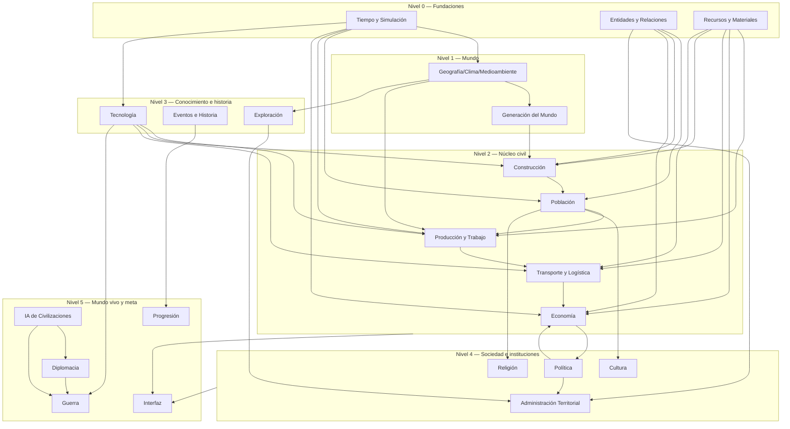
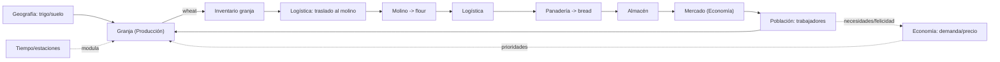

# SYSTEM_DEPENDENCY_MAP — Civilization Evolutions

> **Phase 2 — Mapa de dependencias e interacción entre sistemas.** Qué sistemas deben existir antes que otros, cómo fluye la información, cómo se propagan los eventos y qué cadencia de actualización necesita cada uno. Fuentes: Maestro §6, fichas de los GDD (ver [DOCUMENTATION_INDEX.md](DOCUMENTATION_INDEX.md)). Complementa [SYSTEM_ARCHITECTURE_MAP.md](SYSTEM_ARCHITECTURE_MAP.md).
> Versión 1.1 · Última actualización 2026-11-04 · Estado: conceptual.

## A. Grafo de dependencias (orden de implementación fiable)

Un sistema **debe** existir antes que otro si el segundo no puede funcionar sin él.

**Lectura:** implementar de abajo hacia arriba. **Nivel 0** (Tiempo, Entidades, Recursos) es prerequisito de casi todo. El prototipo jugable vive en Niveles 0–3 (ver [DEVELOPMENT_ROADMAP.md](DEVELOPMENT_ROADMAP.md)).

## A.2 Clasificación de sistemas y dueño autoritativo del dato

> **Clase:** *Fundacional* = base de la que casi todo depende; *Núcleo (core)* = corazón de la simulación civil y del primer playable; *De apoyo (supporting)* = enriquece el núcleo, no imprescindible para el MVP; *Avanzado* = mundo vivo/meta, etapas tardías; *Transversal* = cruza a todos (no encaja en un nivel).
> **¿Opera independiente en desarrollo temprano?** = si puede desarrollarse y probarse en aislamiento (con stubs mínimos) antes de integrar el resto. Útil para paralelizar.
> **Dueño autoritativo del dato** = única fuente de verdad; los demás **leen** (no copian). Alinea con [SHARED_DATA_MODEL.md](SHARED_DATA_MODEL.md).

| Sistema | Clase | ¿Opera independiente temprano? | Dato del que es **dueño autoritativo** |
|---|---|---|---|
| Tiempo | **Fundacional** | **Sí** (reloj puro, ya en SimCore) | fecha/estación/velocidad, cadencias |
| Entidades y Relaciones | **Fundacional** | **Sí** (identidad/relaciones puras) | id estable y relaciones de toda entidad |
| Recursos y Materiales | **Fundacional** | **Sí** (catálogo + inventarios) | catálogo de recursos/materiales e inventarios |
| Geografía/Clima | Fundacional (mundo) | Parcial (necesita Tiempo) | terreno, biomas, clima, existencia de recursos naturales |
| Generación del Mundo | De apoyo | **Sí** (genera a archivo/estado) | estado inicial del mundo (semilla, layout) |
| Construcción | **Núcleo** | Parcial (necesita Recursos/Entidades) | estructuras físicas y su estado de obra/evolución |
| Población | **Núcleo** | Parcial (necesita Entidades/Tiempo) | individuos, hogares, linajes, demografía |
| Producción y Trabajo | **Núcleo** | Parcial (necesita Recursos/Población) | recetas, asignación de trabajo, transformación |
| Transporte y Logística | **Núcleo** | Parcial (necesita Recursos/Geografía) | rutas, movimiento físico de bienes |
| Economía | **Núcleo** | No (integra varios) | precios, mercados, moneda, fiscalidad |
| Tecnología | **Núcleo** (habilitador) | **Sí** (árbol/condiciones puras) | estado de conocimiento por civilización |
| Eventos e Historia | Transversal | **Sí** (bus + registro) | crónica/registro histórico (no origina efectos) |
| Exploración/Expansión | De apoyo | Parcial | conocimiento territorial y ocupación |
| Cultura | De apoyo | Parcial (necesita Población) | identidad cultural, prácticas, difusión |
| Religión | De apoyo | Parcial (necesita Población) | creencias, instituciones religiosas |
| Política y Gobierno | De apoyo | No | forma de gobierno, leyes/políticas, soberanía |
| Administración Territorial | De apoyo | No | regiones administrativas, autoridad local/impuestos |
| Diplomacia | Avanzado | No | relaciones/tratados entre civilizaciones |
| IA de Civilizaciones | Avanzado | No (consume a casi todos) | decisiones y personalidad de las no jugadoras |
| Guerra | Avanzado | No | fuerzas militares, fortificaciones, conflicto |
| Progresión | Avanzado (meta) | **Sí** (lee indicadores) | objetivos, legado, condiciones de fin |
| Interfaz | Transversal | **Sí** (lee todo, no escribe sim) | nada de simulación (solo presentación) |

**Candidatos a paralelizar desde ya** (operan independientes): Tiempo, Entidades, Recursos, Tecnología, Eventos, Progresión, Interfaz. Son los que un fork puede avanzar con stubs sin bloquear el núcleo.

## B. Dependencias por sistema

| Sistema | Fundacionales requeridos | Directas | Influye a | Consume info de |
|---|---|---|---|---|
| Tiempo | — | — | todos | Geografía (estaciones por región) |
| Entidades | — | — | todos | — |
| Recursos | — | — | económicos | Geografía (dónde hay recursos) |
| Geografía | Tiempo | Recursos | Generación, Construcción, Producción, Exploración | Tiempo |
| Generación | Geografía, Recursos | — | Construcción, Exploración | Geografía, Recursos |
| Construcción | Entidades, Recursos, Geografía | Producción, Tecnología | Población, Economía, Cultura | Materiales, mano de obra, tecnología |
| Población | Tiempo, Entidades, Construcción | Economía | Producción, Cultura, Religión, Política | vivienda, necesidades, salud |
| Producción | Recursos, Población, Construcción, Tecnología | Logística | Economía | insumos, trabajadores, recetas |
| Logística | Recursos, Geografía | Producción, Economía | Comercio, Militar, Exploración | inventarios, rutas, distancia |
| Economía | Recursos, Población, Producción, Logística | — | Política, Progresión | stocks, trabajo, precios |
| Tecnología | Tiempo, Economía (financia) | — | Producción, Construcción, Logística, Militar | condiciones/conocimiento |
| Eventos | Tiempo | todos (recibe) | Progresión, UI | hechos de cada sistema dueño |
| Exploración | Geografía, Logística | Administración | Diplomacia, Militar | conocimiento territorial |
| Cultura/Religión | Población | Construcción, Política | Diplomacia, Población | afiliación, prácticas |
| Política | Población, Economía | Administración, Militar | Economía, Población | intereses, estabilidad |
| Administración | Política, Entidades | Economía | Población | territorios, impuestos |
| Diplomacia | Entidades, Exploración | IA, Guerra, Comercio | Eventos | relaciones, tratados |
| IA civilizaciones | todos los del jugador | Diplomacia | Mundo vivo | estado propio (sin omnisciencia) |
| Guerra | Logística, Población, Construcción, Diplomacia | — | Economía, Política, Eventos | fuerzas, fortificaciones |
| Progresión | Tiempo, Eventos | — | — | indicadores de todos |
| Interfaz | — (lee todos) | — | — | estado de simulación |

## C. Flujo de información (ejemplo: cadena alimentaria)

## D. Propagación de eventos (consecuencias transversales)

| Evento | Cadena de consecuencias (sistemas) |
|---|---|
| **Descubrimiento de metalurgia** | Tecnología habilita → Producción (nuevas recetas/herramientas) → Construcción (nuevos materiales) → Militar (armas) → Economía (nuevos bienes) → Cultura (evolución visual) → Eventos (registro). |
| **Nuevo asentamiento** | Exploración/Expansión funda → Entidades crea identidad → Población asigna habitantes → Construcción habilita obra → Economía/Logística conecta → Administración lo agrupa en región → Eventos registra. |
| **Crecimiento de población** | Población sube → Construcción (demanda de vivienda) → Economía (más consumo/trabajo) → Producción (más mano de obra) → Política (presión social) → posible transición individual→agregado (LOD). |
| **Escasez de alimentos** | Producción/Geografía (mala cosecha/estación) → Economía (precios suben) → Población (hambre/salud/migración) → Política (inestabilidad) → Eventos (crisis) → posible conflicto. |
| **Construcción de un camino** | Construcción/Logística crea ruta → Transporte (menor costo/tiempo) → Economía (integración de mercados) → Exploración/Expansión (acceso) → Construcción (crecimiento urbano a lo largo del camino). |
| **Nueva religión** | Religión surge → Población (afiliación, felicidad) → Cultura (festividades, arte) → Construcción (templos) → Política (legitimidad) → Diplomacia (relaciones religiosas) → Eventos. |
| **Acuerdo comercial** | Diplomacia firma → Economía/Logística (flujo de bienes, precios) → Producción (insumos nuevos) → Cultura (intercambio) → Eventos (memoria histórica). |

Regla (DC-14): el **evento** lo origina el sistema dueño del hecho; Eventos **registra** y notifica; ningún efecto de juego nace del sistema de Eventos.

## E. Cadencia de actualización

| Cadencia | Sistemas | Criterio |
|---|---|---|
| **Frecuente** (tick de simulación) | Movimiento/acción de unidades activas, animación, UI de depuración | Solo lo visible/activo; **no** todo por `Tick()`. |
| **Periódica** (día/semana) | Producción, consumo, necesidades, logística, salud | Ciclos internos del reloj; conservan estado entre actualizaciones. |
| **Estacional** | Agricultura, clima, algunos precios | Ligado a estaciones del reloj. |
| **Anual / por hito** | Investigación, demografía agregada, evolución histórica, evaluación de eventos, IA estratégica | Baja frecuencia; apta para agregación. |
| **Por evento** (event-driven) | Reacciones a Descubrimiento/Construcción/Escasez/etc. | Delegados/eventos tipados, sin polling ni acoplamiento. |

**Principios (plan técnico §6):** el reloj es independiente del FPS; los sistemas no dependen de `Tick()` para cada operación; se usan intervalos controlados + eventos. A mayor escala, mayor agregación y menor frecuencia (DR-10).

## F. Caminos críticos (riesgo de bloqueo)

1. **Tiempo** mal definido bloquea todo (cadencias, envejecimiento, estaciones). → definir DR-09.
2. **Recursos/Entidades** son base de datos compartida: definir su identidad antes que economía/población evita duplicación (F-09/F-10, RISK-02).
3. **Geografía→Recursos→Producción→Logística→Consumo** es la espina dorsal del prototipo.
4. **Tecnología** debe integrarse como marco **compartido** (no efectos aislados) para no reescribir sistemas después (RISK-05, HISTORICAL_EVOLUTION_FRAMEWORK).
